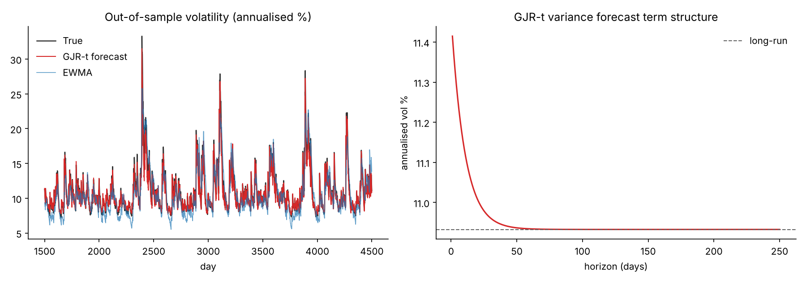

# GARCH volatility forecasting

GARCH(1,1) and GJR-GARCH(1,1) estimated by (quasi) maximum likelihood with Gaussian or Student-t
innovations, multi-step variance forecasts, and an out-of-sample comparison against rolling-window
and EWMA baselines using QLIKE/MSE losses, Mincer–Zarnowitz regressions and Diebold–Mariano tests.

## Model

$$r_t = \sigma_t z_t,\qquad \sigma_t^2 = \omega + (\alpha + \gamma\,\mathbf 1[r_{t-1}<0])\,r_{t-1}^2 + \beta\,\sigma_{t-1}^2$$

$\gamma=0$ is GARCH(1,1); $\gamma>0$ lets negative returns raise volatility more (leverage effect).
Persistence is $\alpha+\gamma/2+\beta$ (for symmetric $z_t$), the long-run variance is
$V=\omega/(1-\text{persistence})$, and the $h$-step forecast mean-reverts geometrically:

$$\mathbb E_T[\sigma_{T+h}^2] = V + (\alpha+\gamma/2+\beta)^{h-1}\,(\sigma_{T+1}^2 - V).$$

Forecasts are scored with MSE and QLIKE $=p/f-\ln(p/f)-1$ against the proxy $p=r_t^2$. Both
remain consistent loss functions under a noisy proxy (Patton, 2011); QLIKE is much more
sensitive to under-prediction.

## Files

| File | Purpose |
|---|---|
| `garch.py` | simulation, variance filter, likelihood, `fit_garch`, forecasts, baselines, loss functions, DM and MZ tests |
| `test_garch.py` | 15 tests: filter equals simulated truth, parameter recovery, leverage and fat-tail detection, mean reversion, **no look-ahead** in rolling forecasts, QLIKE minimised at the truth, DM size/power |
| `run_garch.py` | reproduces every table and the figure below |

Run: `pip install -r ../requirements.txt && python run_garch.py` (about 2.5 minutes; mostly the
refits), tests with `pytest garch -q` from the repo root.

## Study (synthetic data, seed 11)

Data are 4500 days from a GJR-GARCH with $\omega=0.02,\ \alpha=0.03,\ \gamma=0.10,\ \beta=0.88$
and $t_7$ innovations (true persistence 0.96, annualised long-run vol about 11.2%). Truth is known, so
the study measures estimator and forecaster quality rather than making claims about a real market.

### In-sample fit (first 3000 days)

| Model | omega | alpha | gamma | beta | nu | persistence | loglik | BIC |
|---|---|---|---|---|---|---|---|---|
| GARCH-N | 0.0352 | 0.093 | 0.000 | 0.828 | - | 0.921 | -2931.4 | 5886.9 |
| GARCH-t | 0.0346 | 0.099 | 0.000 | 0.825 | 7.24 | 0.924 | -2876.2 | 5784.4 |
| GJR-N | 0.0307 | 0.043 | 0.080 | 0.847 | - | 0.930 | -2922.9 | 5877.9 |
| GJR-t | 0.0313 | 0.048 | 0.084 | 0.839 | 7.37 | 0.930 | -2869.6 | 5779.1 |
| truth | 0.02 | 0.03 | 0.1 | 0.88 | 7.0 | 0.960 | | |

BIC selects the correct specification (GJR with t innovations), and the estimated $\nu$ and $\gamma$
are close to the truth. Persistence is underestimated (0.93 vs 0.96) in this sample: the classic
finite-sample downward bias of GARCH persistence, so long-horizon forecasts revert too fast.

### Out-of-sample one-day variance forecasts (3000 days, parameters refit every 21 days)

| Forecaster | QLIKE | MSE | MZ slope | MZ R² | DM vs GJR-t (QLIKE), p |
|---|---|---|---|---|---|
| Rolling 250d | 1.5408 | 1.09 | 0.25 | 0.001 | 0.000 |
| Rolling 60d | 1.4994 | 1.06 | 0.57 | 0.026 | 0.000 |
| EWMA 0.94 | 1.4451 | 1.02 | 0.74 | 0.060 | 0.000 |
| GARCH-N | 1.4181 | 1.00 | 1.09 | 0.067 | 0.004 |
| GJR-t | 1.4085 | 1.00 | 0.92 | 0.071 | - |
| True variance | 1.4064 | 1.01 | 0.76 | 0.070 | 0.524 |

- QLIKE improves from rolling windows to EWMA to GARCH to GJR-t, and every difference to GJR-t is significant.
  GJR-t is statistically indistinguishable from the true conditional variance (DM p = 0.52).
- The MSE column is nearly flat and cannot separate GARCH from GJR-t. QLIKE has far more power to rank forecasts.
- $R^2$ of at most 0.07 even for the *true* variance is not a failure: the proxy $r_t^2$ is extremely noisy.

Left: out-of-sample volatility; GJR-t tracks the true path closely while EWMA lags spikes and
overshoots on the way down. Right: variance forecast term structure from the last in-sample day,
mean-reverting to the long-run level (10.9% annualised under the fitted model).

## Limitations

- One simulated path; the tables are not averaged over seeds, so small gaps (e.g. GARCH-N vs GJR-t) are indicative.
- Estimation uses pure-Python filtering with L-BFGS-B then Nelder–Mead, which is clear but slow; no analytic gradients.
- Only one-step-ahead forecasts are evaluated; multi-horizon accuracy is untested.

## Reference

Bollerslev (1986); Glosten, Jagannathan & Runkle (1993); Patton (2011), "Volatility forecast
comparison using imperfect volatility proxies", *J. Econometrics*.
