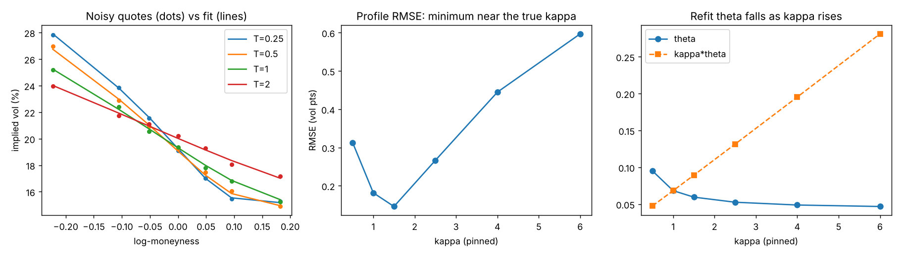

# Heston stochastic volatility

Black–Scholes holds volatility constant, so it can't produce the volatility smile seen in every
equity options market. Heston (1993) makes variance a mean-reverting square-root process that is
correlated with the stock:

$$
dS_t = (r - q) S_t\,dt + \sqrt{v_t}\,S_t\,dW^S_t, \qquad
dv_t = \kappa(\theta - v_t)\,dt + \xi\sqrt{v_t}\,dW^v_t, \qquad
d\langle W^S, W^v\rangle_t = \rho\,dt
$$

This folder prices European options two independent ways and checks that they agree.

## Fourier pricing

The characteristic function of $\ln S_T$ is known in closed form. Prices follow from Gil-Pelaez inversion:

$$
C = S e^{-qT} P_1 - K e^{-rT} P_2, \qquad
P_j = \frac12 + \frac1\pi \int_0^\infty \operatorname{Re}\!\left[\frac{e^{-iu\ln K}\,\varphi_j(u)}{iu}\right] du
$$

`characteristic_function` uses the "little Heston trap" form of Albrecher et al. (2007). Heston's
original form puts a complex logarithm across its branch cut once maturities get long, and the
prices it returns jump. A test prices maturities from 1 to 30 years and checks that the curve
stays smooth.

## Monte Carlo: Andersen's QE scheme

`simulate_qe` implements Andersen's (2008) quadratic-exponential scheme. Each step matches the
exact conditional mean and variance of $v_{t+\Delta}$:

- **Low dispersion** ($\psi \le 1.5$): the scheme draws a scaled non-central chi-square, $a(b+Z)^2$.
- **High dispersion**: it draws from a point mass at zero mixed with an exponential tail.

The variance can't go negative, so the scheme needs no truncation fix. That matters when the
Feller condition $2\kappa\theta \ge \xi^2$ fails, which is the usual case for calibrated equity
parameters. Euler schemes are badly biased in that regime.

## Results

The parameters are $v_0 = 0.04$, $\kappa = 1.5$, $\theta = 0.06$, $\xi = 0.6$, $\rho = -0.7$ (Feller
violated), with $S = 100$, $T = 1$, $r = 3\%$, $q = 1\%$. The QE run used 400,000 paths, 100 steps and seed 1:

| Strike | Fourier | QE Monte Carlo (± 1 s.e.) | Black–Scholes implied vol |
|---|---|---|---|
| 70 | 32.1074 | 32.0953 ± 0.0278 | 28.7% |
| 85 | 19.3569 | 19.3473 ± 0.0234 | 24.2% |
| 100 | 8.8192 | 8.8206 ± 0.0168 | 20.0% |
| 115 | 2.3863 | 2.3890 ± 0.0092 | 16.6% |
| 130 | 0.4009 | 0.4002 ± 0.0041 | 15.2% |

Both methods agree to within one standard error at every strike. Negative spot–vol correlation
produces the familiar equity skew: implied vol falls from 28.7% to 15.2% across strikes.

## Calibration to an implied volatility surface

`calibration.py` fits $(v_0, \kappa, \theta, \xi, \rho)$ to a grid of implied vols with
`scipy.optimize.least_squares` (bounded, trust-region), using the Fourier pricer above.

**Objective.** Residuals are vega-weighted price errors,

$$
r_i = \frac{C_{\text{Heston}}(K_i, T_i) - C_{\text{mkt}}(K_i, T_i)}{\mathcal{V}^{BS}_i},
$$

where $\mathcal{V}^{BS}_i$ is the Black–Scholes vega at the quote's own vol. To first order that is
the implied-vol error, so the optimiser minimises a vol-point error without inverting
Black–Scholes at every step. Reported fit errors are always true implied-vol differences.

**Multi-start.** The surface is not convex in the parameters, so `calibrate` runs from one typical
equity start plus random starts inside a plausible region (fixed seed) and keeps the lowest cost.

**Identifiability.** At the optimum, $(J^\top J)^{-1}$ approximates the covariance of the estimates.
Its correlation matrix, and $\operatorname{cond}(J)$, show which parameters the surface can separate.
`kappa_profile` pins $\kappa$ on a grid and refits the other four, giving a profile of fit quality.

### Results

The test surface has 4 maturities (0.25–2y) × 7 strikes (80–120% of forward), generated from
$v_0=0.04$, $\kappa=1.5$, $\theta=0.06$, $\xi=0.6$, $\rho=-0.7$, $S=100$, $r=3\%$, $q=1\%$. The noisy
surface adds $N(0, 0.2\%)$ noise to each vol (0.2 vol points). Output of `python run_calibration.py`:

| | v0 | kappa | theta | xi | rho | RMSE (vol pts) |
|---|---|---|---|---|---|---|
| true | 0.0400 | 1.5000 | 0.0600 | 0.6000 | -0.7000 | |
| clean fit | 0.0400 | 1.5000 | 0.0600 | 0.6000 | -0.7000 | 0.0000 |
| noisy fit | 0.0400 | 1.4040 | 0.0607 | 0.6009 | -0.7055 | 0.1439 |

Noisy fit: max abs vol error 0.291 vol pts, cond(J) = 635. Profile over pinned kappa (noisy surface):

| kappa | theta | kappa*theta | xi | RMSE (vol pts) |
|---|---|---|---|---|
| 0.5 | 0.0951 | 0.0476 | 0.512 | 0.3129 |
| 1.0 | 0.0683 | 0.0683 | 0.561 | 0.1815 |
| 1.5 | 0.0595 | 0.0893 | 0.610 | 0.1458 |
| 2.5 | 0.0526 | 0.1315 | 0.710 | 0.2663 |
| 4.0 | 0.0488 | 0.1953 | 0.863 | 0.4447 |
| 6.0 | 0.0468 | 0.2811 | 1.074 | 0.5970 |

Reading the results:

- **Noiseless:** all five parameters are recovered to the printed precision.
- **Noisy:** the fit residual is about the noise level (it cannot do better), and $\kappa$ is the least accurate
  parameter. $v_0$, $\xi$ and $\rho$ are tight.
- **$\kappa$–$\theta$ trade-off:** their estimates have correlation −0.93 (and 0.74 with $\xi$) in the Gauss–Newton covariance.
  Pinning $\kappa$ low forces $\theta$ up and vice versa, and the profile RMSE rises on both sides of
  the truth, so on this dense surface $\kappa$ is identified but only loosely.
  With fewer maturities or a narrower strike range the profile would flatten. The data here are synthetic.

## Tests

`test_heston.py` checks:

- **Martingale property:** $\varphi(0) = 1$ and $\varphi(-i)$ equals the forward.
- **Black–Scholes limit:** with $\xi \to 0$, the model matches Black–Scholes at constant variance. When $v_0 \ne \theta$, it matches Black–Scholes at the integrated variance.
- **No static arbitrage:** call prices are decreasing and convex in strike and stay inside the model-free bounds.
- **Skew direction, put–call parity and long-maturity smoothness.**
- **Calibration (`test_calibration.py`):** noiseless parameter recovery, bounds, pinned parameters, noise-level residuals, the $\kappa$–$\theta$ anticorrelation, and a $\kappa$ profile that bottoms out at the truth.
- **Fourier vs. QE:** the two prices agree within 4 standard errors when the Feller condition fails, and simulated paths stay finite and positive under extreme vol-of-vol.

## References

- Heston, S. (1993). A closed-form solution for options with stochastic volatility. *Review of Financial Studies* 6(2).
- Albrecher, H., Mayer, P., Schoutens, W., Tistaert, J. (2007). The little Heston trap. *Wilmott Magazine*.
- Andersen, L. (2008). Simple and efficient simulation of the Heston stochastic volatility model. *Journal of Computational Finance* 11(3).
