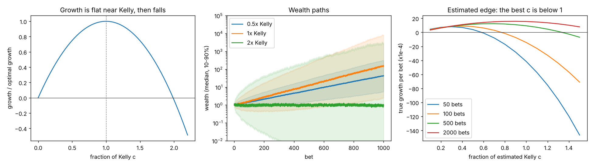

# Kelly criterion position sizing

The Kelly criterion sizes a bet to maximise the long-run growth rate of wealth. This project
implements the closed forms, a numerical solver for arbitrary discrete payoffs, and the
fractional-Kelly rules practitioners use, then checks each claim by simulation.

```bash
cd kelly && python run_kelly.py     # prints the tables below and writes kelly_study.png
pytest -q kelly                     # 22 tests
```



## Math

A bet returns $X > -1$ per unit staked; staking a fraction $f$ gives expected log growth

$$g(f) = \mathbb{E}\big[\log(1 + fX)\big], \qquad f^* = \arg\max_f g(f).$$

* **Binary bet** (win $b$ with probability $p$, lose 1): $f^* = p - (1-p)/b$.
* **Finite distributions**: $g$ is strictly concave on $f < 1/\max\text{loss}$, so a bounded scalar
  search finds $f^*$ (`kelly_discrete`).
* **Gaussian / diffusion limit**: $f^* = (\mu - r)/\sigma^2$ with growth $r + (\mu-r)^2/(2\sigma^2)$,
  the Merton fraction.
* **Fractional Kelly** $c f^*$ in the diffusion limit earns a share $1-(1-c)^2$ of the optimal
  growth (half Kelly: 75%; double Kelly: 0%) and the probability that wealth ever falls to
  $\alpha$ of its start is $\alpha^{2/c-1}$ (full Kelly: $\alpha$ itself).

## Results

All numbers come from `run_kelly.py` on synthetic bets (no market data).

**Sizing a 55% even-odds bet** ($f^* = 0.10$), 1,000 bets, 5,000 paths:

| c (x Kelly) | growth/bet | median wealth | P(wealth<1) | mean max DD | P(ever <= 0.5) |
|---|---|---|---|---|---|
| 0.25 | 0.00219 | 8.9 | 0.003 | 0.370 | 0.007 |
| 0.50 | 0.00375 | 42.6 | 0.009 | 0.621 | 0.114 |
| 1.00 | 0.00501 | 149.7 | 0.062 | 0.884 | 0.480 |
| 1.50 | 0.00374 | 41.9 | 0.216 | 0.973 | 0.746 |
| 2.00 | -0.00014 | 0.9 | 0.512 | 0.995 | 0.908 |

Half Kelly keeps 75% of the growth rate (0.00375 vs 0.00501) while cutting the chance of ever
halving the bankroll from 48% to 11%. Betting more than $2f^*$ has negative growth: wealth
shrinks even though each bet has a positive edge.

**The drawdown law** (51% bet, 40,000 small bets per path, 1,500 paths):

| c | alpha | simulated | alpha^(2/c-1) |
|---|---|---|---|
| 0.5 | 0.5 | 0.127 | 0.125 |
| 0.5 | 0.25 | 0.017 | 0.016 |
| 1.0 | 0.5 | 0.493 | 0.500 |
| 1.0 | 0.25 | 0.240 | 0.250 |

**Why fractional Kelly: estimated edges.** Real edges are estimated. Sizing from $\hat p$
estimated on $n$ past bets (true $p=0.53$, $f^*=0.06$) and scoring each sizing by its *true* growth:

| bets observed | growth full Kelly (x1e-4) | growth half Kelly (x1e-4) | best c | P(g<0) full | P(g<0) half |
|---|---|---|---|---|---|
| 50 | -41.48 | 4.00 | 0.3 | 0.396 | 0.129 |
| 100 | -14.41 | 8.27 | 0.4 | 0.313 | 0.046 |
| 500 | 9.40 | 11.61 | 0.7 | 0.095 | 0.000 |
| 2000 | 15.51 | 12.86 | 0.9 | 0.004 | 0.000 |

With little data, plug-in full Kelly overbets whenever the estimate is too high and loses money
on average; the growth-maximising fraction rises toward 1 only as the sample grows. Fractional
Kelly is therefore a hedge against parameter uncertainty, not just risk aversion.

## Caveats

* The drawdown law is a diffusion-limit result; with large discrete stakes it is only approximate.
* Kelly assumes the edge and odds are known and bets are independent. Correlated bets need the
  multivariate generalisation $f^* = \Sigma^{-1}(\mu - r)$ (not implemented here).
* Simulations use synthetic data; nothing here is a claim about live returns.

## Files

* `kelly.py`: Kelly solvers, growth and drawdown formulas, simulation and estimation-error helpers
* `test_kelly.py`: tests against closed forms, numerical optimum, and Monte Carlo
* `run_kelly.py`: the study that produces the tables and `kelly_study.png`
