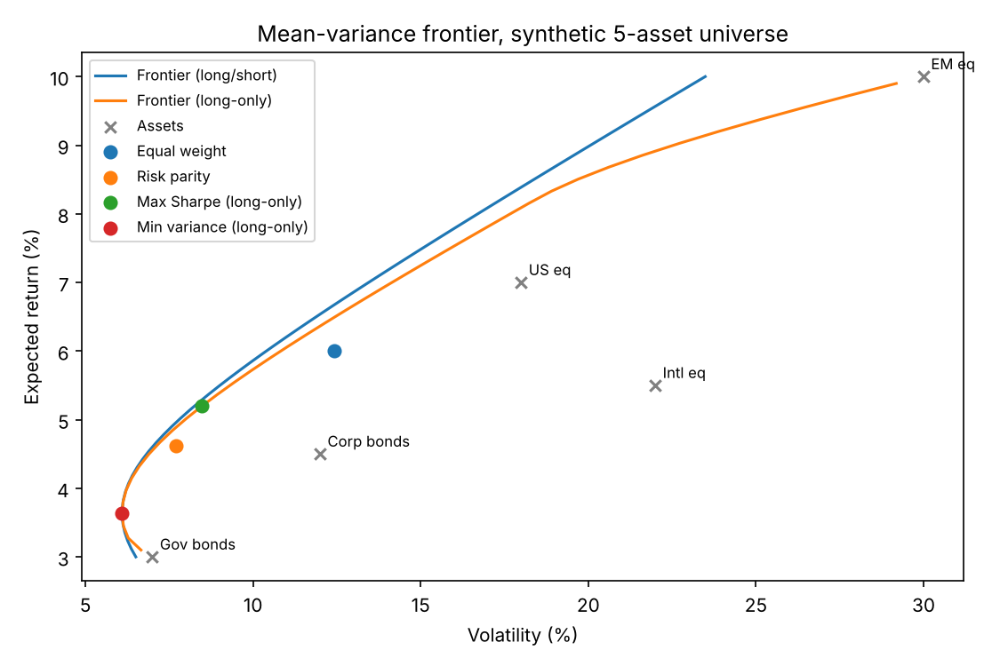

# Portfolio optimisation: mean-variance, risk parity, Black–Litterman

Three ways to turn a covariance matrix (and sometimes return forecasts) into weights, plus a
Monte Carlo study of how they behave when the inputs are *estimated* rather than known.
**All data are synthetic**, drawn from a known $\mu$ and $\Sigma$ for five assets (US equity, international
equity, government bonds, corporate bonds, EM equity), so out-of-sample performance can be scored against the truth.



## Methods

**Mean-variance.** Without constraints the minimum-variance portfolio is
$w = \Sigma^{-1}\mathbf 1 / \mathbf 1^\top\Sigma^{-1}\mathbf 1$, the tangency portfolio is
$w \propto \Sigma^{-1}(\mu - r_f)$, and the frontier is the two-fund family
$w = \Sigma^{-1}(\lambda \mathbf 1 + \gamma \mu)$ with $(\lambda,\gamma)$ from the $2\times2$ system in
$A = \mathbf 1^\top\Sigma^{-1}\mathbf 1$, $B = \mathbf 1^\top\Sigma^{-1}\mu$, $C = \mu^\top\Sigma^{-1}\mu$.
Long-only variants use SLSQP; long-only max Sharpe uses the Charnes–Cooper transform
$\min y^\top\Sigma y \text{ s.t. } y^\top(\mu-r_f)=1,\ y\ge 0$, $w = y/\mathbf 1^\top y$, which is a convex QP.

**Risk parity.** Each asset contributes $w_i(\Sigma w)_i / w^\top\Sigma w$ of portfolio variance; risk parity
sets these to a budget $b_i$ (equal by default). Following Spinu (2013), minimise the convex function
$\tfrac12 x^\top\Sigma x - \sum_i b_i\ln x_i$ by damped Newton and normalise $x$; the first-order condition is
exactly $x_i(\Sigma x)_i = b_i$. With uncorrelated assets the answer is inverse volatility (tested).

**Black–Litterman.** Reverse optimisation gives equilibrium excess returns $\pi = \delta\Sigma w_{mkt}$. Views
$P\mu = Q + \varepsilon$, $\varepsilon\sim N(0,\Omega)$, are combined with the prior $\mu\sim N(\pi,\tau\Sigma)$:

$$
\mu_{BL} = \pi + \tau\Sigma P^\top(\tau P\Sigma P^\top + \Omega)^{-1}(Q - P\pi).
$$

$\Omega$ defaults to $\mathrm{diag}(\tau P\Sigma P^\top)$ (He–Litterman). Tests check the round trip
(optimising the implied returns recovers $w_{mkt}$), the no-surprise case, both confidence limits, and
agreement with the precision-weighted form.

**Ledoit–Wolf shrinkage** of the sample covariance towards a scaled identity is included for the study below.

## Results

`python run_portfolio_opt.py` reproduces everything. True parameters, $r_f = 2\%$:

| Portfolio | US | Intl | Gov | Corp | EM | Return % | Vol % | Sharpe |
|---|---|---|---|---|---|---|---|---|
| Equal weight | 20.0 | 20.0 | 20.0 | 20.0 | 20.0 | 6.00 | 12.43 | 0.322 |
| Min variance | 8.6 | 1.1 | 76.1 | 13.3 | 1.0 | 3.64 | 6.09 | 0.269 |
| Max Sharpe (long/short) | 37.1 | −14.0 | 49.4 | 11.6 | 15.9 | 5.42 | 8.81 | 0.388 |
| Max Sharpe (long-only) | 27.3 | 0.0 | 51.8 | 6.5 | 14.4 | 5.20 | 8.48 | 0.377 |
| Risk parity | 12.4 | 10.0 | 50.8 | 18.2 | 8.6 | 4.62 | 7.69 | 0.341 |

Risk parity gives every asset exactly 20% of variance, which requires holding half the book in the lowest-vol asset.

### Estimation error

1000 trials; each draws 120 monthly returns from the true distribution, estimates $\mu,\Sigma$,
builds weights, and scores them with the **true** $\mu,\Sigma$. The oracle Sharpe is 0.388.

| Strategy | Mean true Sharpe | 5th pct | 95th pct | Mean gross leverage |
|---|---|---|---|---|
| Max Sharpe (long/short) | 0.243 | 0.041 | 0.352 | 7.33 |
| Max Sharpe (long-only) | 0.288 | 0.179 | 0.361 | 1.00 |
| Min variance (sample) | 0.265 | 0.218 | 0.305 | 1.03 |
| Min variance (Ledoit–Wolf) | 0.287 | 0.246 | 0.320 | 1.02 |
| Risk parity | 0.341 | 0.336 | 0.345 | 1.00 |
| Equal weight | 0.322 | 0.322 | 0.322 | 1.00 |

The textbook optimiser is the worst performer: ten years of data are not enough to estimate expected returns,
and the tangency weights are leveraged on that noise. Strategies that need only $\Sigma$ do better, and
shrinkage helps minimum variance. Risk parity edges out equal weight in this universe, but that ranking depends on the assumed $\mu$; the robust
conclusion is the gap between the estimated tangency portfolio and the oracle.
In 200 of the 1000 trials the unconstrained estimate had no valid tangency portfolio (the weights sum to a
non-positive number) and 13 for long-only (no positive estimated excess return); those trials fall back to
equal weight, which flatters both rows slightly.

### Black–Litterman example

$\delta = 2.5$, $\tau = 0.05$, market weights (35, 25, 20, 10, 10)%. Views: international equity returns 10%;
corporates and EM equity are expected to perform equally.

| Asset | Market w % | Implied excess μ % | Posterior excess μ % | Optimal w % |
|---|---|---|---|---|
| US equity | 35.0 | 5.18 | 6.19 | 29.7 |
| Intl equity | 25.0 | 6.28 | 8.04 | 36.3 |
| Gov bonds | 20.0 | 0.06 | 0.01 | 17.0 |
| Corp bonds | 10.0 | 2.40 | 3.03 | 15.0 |
| EM equity | 10.0 | 5.34 | 4.70 | 2.0 |

The views tilt towards international equity and corporates and away from EM, but the posterior stays near the
market portfolio instead of jumping to corner solutions.

## Running

```bash
pip install -r ../requirements.txt
python run_portfolio_opt.py
pytest -q
```
