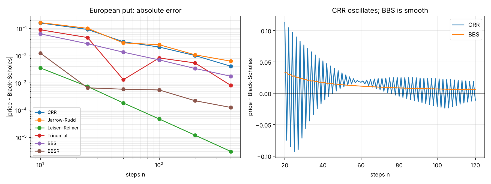

# Binomial and trinomial trees

A recombining tree prices an option by backward induction over a discretised risk-neutral
process:

$$
V_i^{n} = e^{-r\,\Delta t}\,\mathbb{E}^{\mathbb{Q}}\!\left[V^{n+1}\mid \text{node } i\right],
\qquad V_i^{n} \leftarrow \max\!\big(V_i^{n},\,h(S_i^{n})\big)\ \text{(American)}
$$

Trees are the workhorse for American exercise and for Greeks without simulation noise, but the
price converges slowly and *non-monotonically*: the payoff kink sits somewhere between two
terminal nodes, and where it sits changes with $n$. This project implements the standard
remedies and measures them against Black–Scholes.

## Methods (`trees.py`)

| Method | Idea |
|---|---|
| `crr` | Cox–Ross–Rubinstein: $u=e^{\sigma\sqrt{\Delta t}},\ d=1/u$, so $ud=1$ |
| `jr` | Jarrow–Rudd: equal-probability-style tree with the drift built into $u,d$ |
| `lr` | Leisen–Reimer: probabilities from the Peizer–Pratt inversion of $N(d_1),N(d_2)$, which centres the tree on the strike (odd $n$) |
| `trinomial_price` | Boyle trinomial in log space, spacing $\Delta x=\sigma\sqrt{3\Delta t}$, moments matched |
| `bbs_price` | Broadie–Detemple: the final step is replaced by the Black–Scholes formula, removing the kink |
| `bbsr_price` | BBS with Richardson extrapolation, $2V(n)-V(n/2)$ |

All binomial parameterisations match the risk-neutral mean $e^{(r-q)\Delta t}$ exactly (tested).
`binomial_greeks` reads delta, gamma and theta from the first two layers of a CRR tree; because
$ud=1$ the middle node at step 2 sits at spot, so theta needs no bump.

## Results

Reproduce with `python run_trees.py` (all numbers below come from that script).



**European put**, $S=100,\ K=105,\ T=1,\ r=5\%,\ q=2\%,\ \sigma=25\%$. Black–Scholes $=10.800398$.
Absolute error:

| Method | n=10 | n=25 | n=50 | n=100 | n=200 | n=400 |
|---|---:|---:|---:|---:|---:|---:|
| CRR | 1.6e-01 | 9.3e-02 | 3.3e-02 | 2.1e-02 | 1.0e-02 | 4.1e-03 |
| Jarrow-Rudd | 1.7e-01 | 1.0e-01 | 3.0e-02 | 2.5e-02 | 1.1e-02 | 6.3e-03 |
| Leisen-Reimer | 3.6e-03 | 7.5e-04 | 1.8e-04 | 4.8e-05 | 1.2e-05 | 3.1e-06 |
| Trinomial | 9.0e-02 | 4.7e-02 | 1.3e-03 | 8.3e-03 | 5.5e-03 | 8.2e-04 |
| BBS | 6.4e-02 | 2.8e-02 | 1.4e-02 | 7.1e-03 | 3.4e-03 | 1.8e-03 |
| BBSR | 1.3e-02 | 6.6e-04 | 5.9e-04 | 5.6e-04 | 2.2e-04 | 1.3e-04 |

- CRR, JR and the trinomial all converge at $O(1/n)$ but not smoothly (the trinomial's 1.3e-3
  at $n=50$ is a lucky strike alignment, not better convergence).
- Leisen–Reimer is smooth and over 1000 times more accurate than CRR at $n=400$ here.
- BBS is smooth and halves the error each time $n$ doubles; Richardson then removes the leading
  term, but the remaining error is not monotone.

**American put**, $S=K=100,\ r=5\%,\ q=0,\ \sigma=20\%,\ T=1$. Reference is BBSR at $n=4000$
($6.09038$), so it is a converged tree value, not an independent closed form.

| Method | n=50 | n=200 | n=800 | time n=800 (ms) |
|---|---:|---:|---:|---:|
| CRR | 6.07373 | 6.08638 | 6.08940 | 16 |
| Jarrow-Rudd | 6.11806 | 6.08731 | 6.09028 | 17 |
| Leisen-Reimer | 6.08357 | 6.08881 | 6.09001 | 14 |
| Trinomial | 6.05391 | 6.08141 | 6.08813 | 15 |
| BBS | 6.09899 | 6.09295 | 6.09111 | 98 |
| BBSR | 6.09364 | 6.09075 | 6.09046 | 119 |

BBS costs more because the last layer is evaluated with a Python-level Black–Scholes call per
node; it could be vectorised. Timings are single runs on one machine and only indicative.

**Early-exercise premium and tree Greeks** (CRR, $n=1000$, $K=100$):

| Spot | European | American | Premium | Delta | Gamma | Theta |
|---:|---:|---:|---:|---:|---:|---:|
| 80 | 16.9826 | 20.0000 | 3.0174 | -1.0000 | -0.0000 | 0.0000 |
| 90 | 10.2151 | 11.4934 | 1.2783 | -0.6833 | 0.0313 | -1.4178 |
| 100 | 5.5715 | 6.0896 | 0.5181 | -0.4111 | 0.0230 | -2.2402 |
| 110 | 2.7873 | 2.9879 | 0.2005 | -0.2236 | 0.0147 | -2.1747 |
| 120 | 1.2928 | 1.3678 | 0.0751 | -0.1111 | 0.0082 | -1.6351 |

At spot 80 the put is exercised immediately (price equals intrinsic $K-S=20$, delta $-1$, zero
gamma and theta). The delta and gamma at that boundary are read from nodes that are all in the
exercise region, so they are exact there but jump discontinuously nearby; near the exercise
boundary tree gamma is unreliable.

## Tests (`test_trees.py`)

24 tests: convergence to Black–Scholes for every method and both option types, matching the
risk-neutral mean, put–call parity on the European tree, American $\ge$ European and $\ge$
intrinsic, American call without dividends equals European, deep ITM put equals intrinsic,
binomial and trinomial agreeing on an American put, the ~6.09 American put benchmark, Greeks vs
finite differences of Black–Scholes, monotonicity in volatility, and input validation.

```bash
pip install -r requirements.txt
pytest -q trees
python trees/run_trees.py
```
