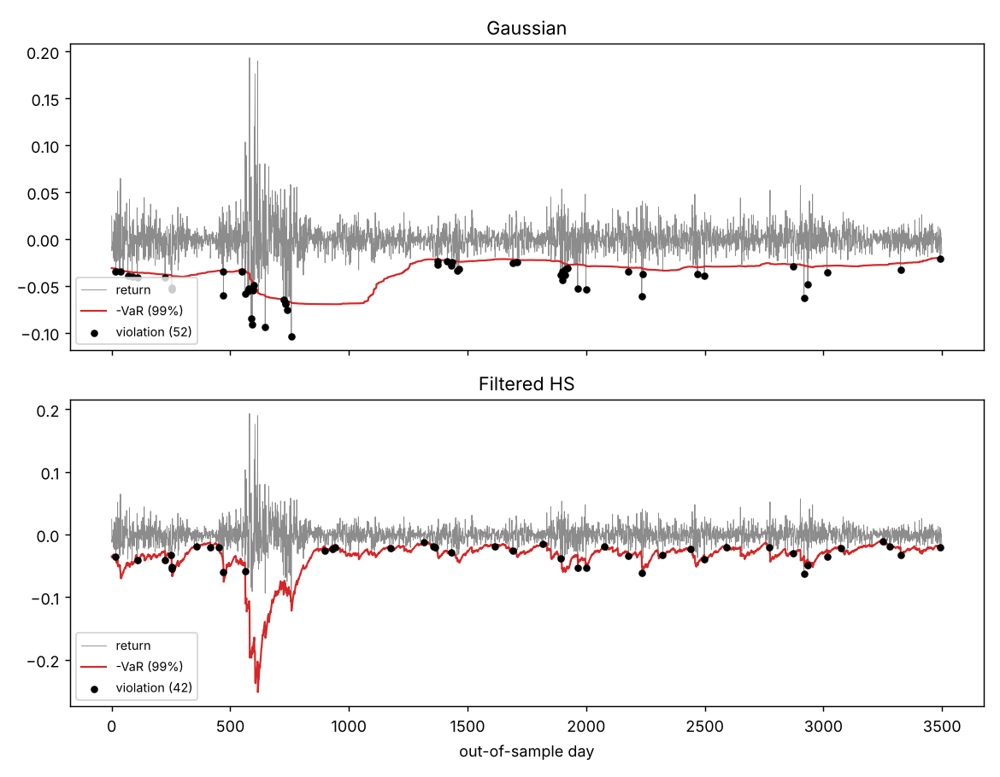

# VaR and Expected Shortfall backtesting

A risk number is only useful if it is right about how often it is wrong. This folder builds four
one-day Value-at-Risk (VaR) and Expected Shortfall (ES) forecasters and scores them with the
standard statistical backtests: Kupiec, Christoffersen, the Basel traffic light, and the
Acerbi–Székely ES test.

With $L_t = -r_t$ the loss and $\alpha = 1\%$ the tail probability,

$$
\mathrm{VaR}_t = \inf\{x : P(L_t > x \mid \mathcal F_{t-1}) \le \alpha\}, \qquad
\mathrm{ES}_t = E[L_t \mid L_t > \mathrm{VaR}_t,\ \mathcal F_{t-1}]
$$

A violation is a day with $L_t > \mathrm{VaR}_t$. A correct model violates with probability $\alpha$
every day, independently of the past.

## Forecasters

All use a rolling window of 500 days and only data available before day $t$.

| Model | VaR |
|---|---|
| Historical | empirical $\alpha$-quantile of the window |
| Gaussian | $-z_\alpha\,\hat\sigma$, with $\hat\sigma$ the window RMS return |
| EWMA | $-z_\alpha\,\sigma_t$, with RiskMetrics $\sigma_t^2 = 0.94\,\sigma_{t-1}^2 + 0.06\,r_{t-1}^2$ |
| Filtered HS | quantile of EWMA-standardised returns $r_s/\sigma_s$, rescaled by today's $\sigma_t$ |

## Backtests

- **Kupiec (1995) proportion of failures.** With $x$ violations in $n$ days and $\hat\pi = x/n$,
  $$\mathrm{LR}_{uc} = -2\ln\frac{(1-\alpha)^{n-x}\alpha^x}{(1-\hat\pi)^{n-x}\hat\pi^x} \sim \chi^2_1.$$
  It only counts violations, so it cannot see clustering.
- **Christoffersen (1998) independence.** Fits a first-order Markov chain to the hit sequence and tests
  $P(\text{hit}\mid\text{hit}) = P(\text{hit}\mid\text{no hit})$, $\chi^2_1$. The sum $\mathrm{LR}_{cc} = \mathrm{LR}_{uc} + \mathrm{LR}_{ind}$ is the conditional coverage test, $\chi^2_2$.
- **Basel traffic light.** Zones from the binomial CDF of the violation count over 250 days: green below 95%,
  yellow below 99.99%, red above. At 99% this gives 0–4, 5–9 and 10+ violations.
- **Acerbi–Székely $Z_2$.** $Z_2 = \frac{1}{T\alpha}\sum_t \frac{L_t\,\mathbf 1\{L_t > \mathrm{VaR}_t\}}{\mathrm{ES}_t} - 1$, which is zero in expectation for a correct ES and positive when ES is understated.

## Results

Data are **synthetic**: 4,000 days of GARCH(1,1) returns with unit-variance Student-$t_6$ innovations
($\omega = 2\times10^{-6}$, $\alpha_{\mathrm G} = 0.09$, $\beta = 0.90$, seed 3). Volatility clusters and tails are
fat, as in real equity returns. The first 500 days seed the window, leaving 3,500 out-of-sample days,
so 35 violations are expected at 99%. Reproduce with `python run_backtest.py`.

| Model | Violations | Rate | Kupiec p | Independence p | Cond. coverage p | ES $Z_2$ |
|---|---|---|---|---|---|---|
| Historical | 43 | 1.23% | 0.189 | 0.558 | 0.356 | +0.31 |
| Gaussian | 52 | 1.49% | 0.007 | 0.049 | 0.004 | +0.75 |
| EWMA (0.94) | 60 | 1.71% | 0.000 | 0.977 | 0.001 | +0.86 |
| Filtered HS | 42 | 1.20% | 0.249 | 0.532 | 0.423 | +0.19 |

Worst rolling 250-day window: Historical 13 violations (red), Gaussian 14 (red), EWMA 9 (yellow), Filtered HS 8 (yellow).



What the numbers show:

- **Gaussian fails** on coverage and conditional coverage: thin tails understate a 99% quantile, and a slow
  window RMS reacts late to a volatility spike (the long run of violations in the figure).
- **EWMA reacts to clustering**: its violations are independent (p = 0.98), but the Gaussian shape still
  puts the quantile too close, so its rate is 1.71% and it fails Kupiec. Independence and coverage are
  different failures, and the tests separate them.
- **Filtered HS** keeps the empirical tail shape and the volatility scaling, and is the only model close
  to 1% on both counts with the lowest ES bias ($Z_2$ = +0.19; the other three understate ES by 31–86%).
- Passing a test at one seed is weak evidence: with 35 expected violations the Kupiec test has limited power.
  Historical simulation also passes here, though its worst year is red.

## Tests

`test_var_backtest.py` (19 tests) checks the Gaussian VaR/ES against closed forms on i.i.d. normal data,
ES $\ge$ VaR, that no forecast uses same-day data, the EWMA recursion, Kupiec against a hand-computed
likelihood ratio, that independence rejects clustered hits that Kupiec cannot distinguish from spread-out
ones, $\mathrm{LR}_{cc}$ as the sum of its parts, the published Basel zones, the Kupiec test's size by
simulation (≈5%), and the $Z_2$ statistic with a correct and an understated ES.

```bash
pip install -r ../requirements.txt matplotlib
pytest -q
python run_backtest.py   # prints the tables, writes var_backtest.png
```
