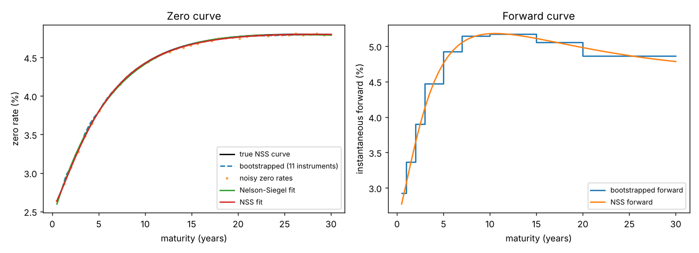

# Yield curve: bootstrapping and Nelson–Siegel–Svensson

Every fixed-income price starts from a discount curve $D(t)$. Market quotes only give a few
instruments (deposits and par swaps), so the curve is built in one of two ways:

1. **Bootstrapping** an exact curve that reprices every quote, node by node.
2. **Parametric fitting** of a smooth curve with few parameters (Nelson–Siegel–Svensson).

This project implements both and compares them. **All market data here are synthetic**, generated
from a known NSS curve, so the true curve is available for scoring.

## Bootstrapping

Zero rates are continuously compounded, $z(t) = -\ln D(t)/t$. Between nodes, $\ln D$ is linear in $t$,
which is the same as a piecewise-constant instantaneous forward rate. Instruments are processed in
order of maturity:

- A **deposit** with simple rate $r$ and maturity $T$ gives $D(T) = 1/(1 + rT)$ directly.
- A **par swap** with annual fixed payments at $1, \dots, n$ and rate $s$ satisfies

$$
s \sum_{i=1}^{n} D(i) = 1 - D(n).
$$

When some annual dates sit between nodes, their $D(i)$ depend on the new node through the
interpolation. So `bootstrap` solves for $D(n)$ with Brent's method rather than a closed-form recursion.
With a swap at every annual maturity the solution reduces to the textbook recursion, and a test checks this.

## Nelson–Siegel–Svensson

$$
z(t) = \beta_0 + \beta_1 \frac{1 - e^{-t/\tau_1}}{t/\tau_1}
+ \beta_2\left(\frac{1 - e^{-t/\tau_1}}{t/\tau_1} - e^{-t/\tau_1}\right)
+ \beta_3\left(\frac{1 - e^{-t/\tau_2}}{t/\tau_2} - e^{-t/\tau_2}\right)
$$

$\beta_0$ is the long rate, $\beta_0 + \beta_1$ the short rate, $\beta_2$ and $\beta_3$ are humps at
scales $\tau_1$ and $\tau_2$. Setting $\beta_3 = 0$ gives Nelson–Siegel.

For fixed $(\tau_1, \tau_2)$ the model is **linear** in the betas. `fit_nss` therefore uses variable
projection: ordinary least squares for the betas inside, a coarse grid search over the taus, then a
Nelder–Mead polish. The grid matters because the two hump loadings are nearly collinear and a
local search alone gets stuck.

## Results

`python run_yield_curve.py` reproduces everything below (true curve: $\beta = (4.5\%, -2\%, -1.5\%, 2\%)$,
$\tau_1 = 1.8$, $\tau_2 = 9$).

**Bootstrap** from 2 deposits (3m, 6m) and 9 par swaps (1, 2, 3, 5, 7, 10, 15, 20, 30y), no noise: the
zero curve is within 4.81 bp of the truth at worst (rms 1.14 bp). The error comes only from
log-linear interpolation of the discount factors between sparse swap maturities.

**Fits** to 40 zero rates between 0.5 and 30 years with 1 bp Gaussian noise (seed 7):

| Model | In-sample rmse (bp) | Error vs truth, 0.5–30y: rms / max (bp) | Error at 40y (bp) |
|---|---|---|---|
| Nelson–Siegel | 1.38 | 1.00 / 3.75 | −0.81 |
| NSS | 0.74 | 0.51 / 0.84 | 1.78 |

NSS removes the systematic misfit of Nelson–Siegel, which is limited to a single hump. The in-sample rmse
of 0.74 bp is below the 1 bp noise level, a sign of mild overfitting from the two extra parameters.
Extrapolation past the data (40y) is not better for NSS in this one draw, so the table does not
claim NSS is safer outside the fitted range.



The right panel shows the main practical difference: bootstrapped forwards are a step function that
jumps at the nodes, while the NSS forward curve is smooth.

## Running

```bash
pip install -r ../requirements.txt
pytest -q
python run_yield_curve.py
```

## Limitations

Single curve with annual fixed legs, no day counts, no OIS/projection split and no calendar. Interpolation
is log-linear in discount factors, so forwards are discontinuous. Smoother schemes (monotone convex)
are left as a next step.
